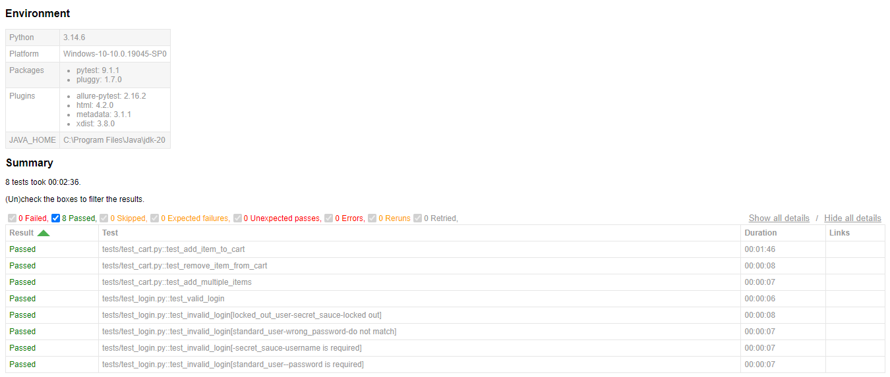
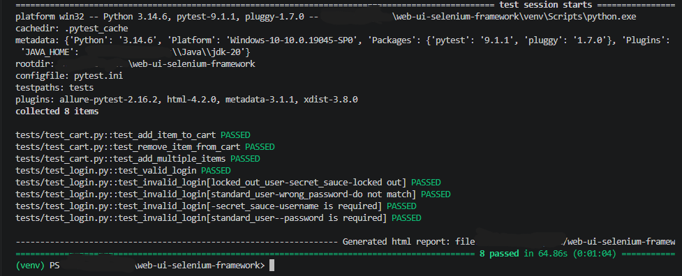

# Web UI Test Automation Showcase (Selenium + Pytest)


> A production-style web UI automation framework I built to demonstrate how I set up
> reliable, maintainable test automation for web applications.

**Built by:** AJIT AVHAD, Senior Automation QA Engineer
**Available for freelance:** web and mobile UI test automation
**Contact:** ajitavhad333@gmail.com | [LinkedIn](https://www.linkedin.com/in/ajit-avhad)

---

## About this project

This repository is a working sample of the framework I would build for your product.
To keep it public and safe to share, I applied it to the **Sauce Labs demo store**
([saucedemo.com](https://www.saucedemo.com)), an open practice application provided
for test automation.

The same structure and practices can be applied to your own web application.

## What the client gets from this kind of framework

| Client need | How this framework addresses it |
|---|---|
| Faster regression testing | Core flows are automated and run in minutes, in parallel |
| Stable tests, not flaky ones | Explicit waits and reusable page objects instead of fixed delays |
| Easy maintenance | A UI change means editing one page object, not dozens of tests |
| Clear failure evidence | Screenshots on failure plus an HTML report |
| Works with your pipeline | Headless mode and command-line options for CI |
| Handover-ready | Readable structure, documented run commands |

## Flows covered

| Area | Scenarios |
|---|---|
| **Login** | Valid login, locked-out user, wrong password, empty username, empty password |
| **Cart** | Add an item, remove an item, add multiple items |

8 automated tests in total, split into `smoke` and `regression` groups so a quick check or a full run is one command.

## Tech stack

- **Python 3.10+**
- **Selenium 4**: browser automation
- **Pytest**: test runner, fixtures, parametrization, markers
- **pytest-html**: test reports
- **pytest-xdist**: parallel execution
- **Git and GitHub**: version control

## Framework design

- **Page Object Model**: locators and page actions live in `pages/`, tests stay short and readable.
- **BasePage with explicit waits**: shared click, type, and read methods that wait for the element, which removes most timing-related flakiness.
- **Fixtures in `conftest.py`**: one place for browser setup, teardown, and a ready `logged_in_driver`.
- **Data-driven tests**: the login negative cases run from a single parametrized test.
- **Cross-browser**: Chrome (default), Brave, and Firefox through one `--browser` option.
- **Headless mode** for CI servers.
- **Automatic screenshot on failure**, saved to `screenshots/`.

## Project structure

```
web-ui-selenium-framework/
├── .github/workflows/tests.yml   # CI pipeline
├── pages/                        # Page objects
│   ├── base_page.py
│   ├── login_page.py
│   ├── inventory_page.py
│   └── cart_page.py
├── tests/
│   ├── conftest.py               # Fixtures, CLI options, failure screenshots
│   ├── test_login.py
│   └── test_cart.py
├── pytest.ini
├── requirements.txt
└── README.md
```

## Sample results

<!-- Add your own screenshots here after running the tests -->
**HTML report:**


**Terminal run:**


## Run it yourself

```bash
git clone https://github.com/ajitavhad-333/web-ui-selenium-framework.git
cd web-ui-selenium-framework
python -m venv venv
venv\Scripts\activate          # Mac/Linux: source venv/bin/activate
pip install -r requirements.txt
```

```bash
pytest                                    # all tests (Chrome)
pytest --headless                         # no browser window
pytest --browser brave                    # Brave
pytest --browser firefox                  # Firefox
pytest -m smoke                           # quick smoke check
pytest -n 4 --headless                    # parallel run
pytest --html=report.html --self-contained-html
```

Custom Brave location: `pytest --browser brave --brave-path "C:\path\to\brave.exe"`

## Skills demonstrated

- Designing a scalable UI automation framework from scratch
- Writing stable, maintainable locators and page objects
- Structuring tests for smoke and regression runs
- Cross-browser and headless execution
- Producing clear reports and failure evidence
- Setting up automated runs through GitHub Actions

## How I can help you

- **Framework setup**: a clean automation framework tailored to your web app
- **Regression suite**: automating your critical user journeys
- **Migration**: moving existing suites to a more stable structure
- **Mobile UI automation**: Appium-based testing for your Android and iOS apps
- **Ongoing QA support**: monthly retainer for test maintenance and new coverage

**Let's talk:** ajitavhad333@gmail.com | [LinkedIn](https://www.linkedin.com/in/ajit-avhad)

---

*Note: This project runs against a public demo application for portfolio purposes. The credentials used are the publicly documented demo logins.*